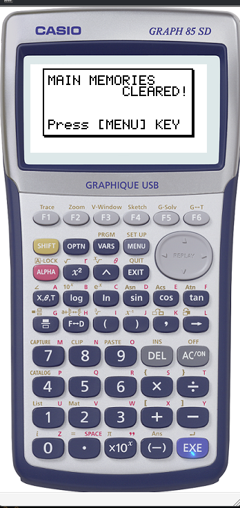

# CASIO GRAPH 85 — émulateur pour Linux

Ce dépôt contient deux choses distinctes :

1. une **distribution Linux de l'émulateur officiel CASIO GRAPH 85**
   (`GRAPH85emulator.exe`, version 01.02.0000.0100, © 2005 CASIO COMPUTER
   CO., LTD.), exécuté via Wine, accompagnée d'une étude de rétro-ingénierie
   complète du binaire ;
2. un **prototype natif Linux** (`native/`, SDL2), réimplémentation partielle
   de l'interface et du calcul, qui n'utilise ni Wine ni le binaire Windows.

L'émulateur d'origine est un exécutable Windows 32 bits (MFC 6.0, compilé avec
Visual C++ 6.0 le 22 septembre 2005). Il est exécuté via **Wine**, sans
modification du binaire. Un petit lanceur natif Linux s'occupe de localiser
Wine, de préparer un préfixe Wine privé et de démarrer l'application.

> **Distinction importante.** La distribution Wine n'est **pas** un portage
> natif : seul le lanceur est un binaire Linux natif, le code de l'émulateur
> reste le binaire Windows original. Le prototype `native/` est, lui, un
> vrai binaire Linux autonome, mais il ne réimplémente qu'une partie de
> l'interface (RUN et GRAPH) et aucun micrologiciel SH-3. Voir
> `native/README.md` et `REPORT.md` § Limites.



## Démarrage rapide

Prérequis :

- un noyau Linux x86-64 ;
- **Wine** avec prise en charge des applications 32 bits (`wine` ≥ 8,
  testé avec Wine 11.21) ;
- `gcc`/`cc`, `make` et `tar` pour compiler le lanceur.

```sh
./build.sh dist          # compile le lanceur + crée dist/GRAPH85 et l'archive
./dist/GRAPH85/graph85   # lance l'émulateur (Wine)

make native              # compile le prototype natif build/graph85-native
make run-native          # lance le prototype natif (sans Wine)
```

Ou directement depuis les sources :

```sh
make run                 # compile et lance l'émulateur
```

Au premier démarrage, le lanceur crée un préfixe Wine privé dans
`~/.local/share/graph85/wineprefix`. L'initialisation peut prendre quelques
dizaines de secondes ; les lancements suivants sont immédiats.

## Construction et installation

```sh
make                     # compile build/graph85 et build/graph85-native
make check               # vérifie la détection Wine/exe/préfixe
make dist                # bundle portable dist/GRAPH85 + .tar.gz
make dist-native         # bundle natif seul (sans Wine ni binaire Windows)
sudo make install        # installe dans /usr/local (PREFIX=... pour changer)
sudo make install-native # installe uniquement le prototype natif
sudo make uninstall
make clean
```

Le prototype natif nécessite `libsdl2-dev` et `libpng-dev` (voir
`native/README.md`).

`make install` installe :

| Élément | Destination |
|---|---|
| lanceur | `$(PREFIX)/bin/graph85` |
| prototype natif | `$(PREFIX)/bin/graph85-native` |
| artwork clavier | `$(PREFIX)/share/graph85/keypad.png` |
| émulateur | `$(PREFIX)/share/graph85/GRAPH85emulator.exe` |
| entrée de menu | `$(PREFIX)/share/applications/graph85.desktop` |
| icônes 16→256 px | `$(PREFIX)/share/icons/hicolor/*/apps/graph85.png` |

L'entrée « Émulateur CASIO GRAPH 85 » apparaît alors dans le menu des
applications. `DESTDIR` est honoré pour l'empaquetage.

## Utilisation du lanceur

```
graph85 [OPTIONS] [-- ARGS_EMULATEUR...]

  --exe PATH        chemin de GRAPH85emulator.exe
  --prefix PATH     préfixe Wine à utiliser
  --wine PATH       exécutable Wine à utiliser
  --keep-prefix     ne pas créer le préfixe s'il est absent
  --print-config    affiche exe/préfixe/Wine détectés et quitte
  -h, --help        aide
  -V, --version     version
```

Variables d'environnement équivalentes : `GRAPH85_EXE`, `GRAPH85_PREFIX`,
`GRAPH85_WINE`, `GRAPH85_KEEP_PREFIX=1`. Le lanceur positionne `WINEPREFIX`,
puis `WINEDEBUG=-all` et `WINEDLLOVERRIDES=mscoree,mshtml=` s'ils ne sont pas
déjà définis (l'application n'utilise ni .NET ni le moteur HTML de Wine).

En mode portable, placez `GRAPH85emulator.exe` à côté du lanceur : il sera
détecté automatiquement. Sinon, le lanceur cherche aussi dans
`../share/graph85/` et `../lib/graph85/`.

## Données de l'application

L'émulateur utilise la clé de registre `HKCU\Software\CASIO\GY363` :

| Valeur | Rôle |
|---|---|
| `LCDDISP` | affichage de l'écran LCD |
| `DISPZOOM` | facteur de zoom (2 par défaut) |
| `CAPFOLDER` | dossier de capture d'écran |
| `CAPFILE` | mode de nommage des captures |
| `CAPSLOCK` | verrouillage de la capture |
| `KEYTABLE` | chemin de la table de correspondance clavier (`Gy363.keys`) |
| `POS_TOP`, `POS_LEFT` | position de la fenêtre |

Le fichier `gy363.fls` contient la mémoire de la calculatrice et
`Gy363.keys` la table clavier ; leur emplacement dépend de la configuration
CASIO. Pour repartir d'une calculatrice vierge, supprimez `gy363.fls` dans
le préfixe Wine et relancez l'émulateur.

## Clavier

Les touches de la calculatrice se cliquent à la souris. Le gestionnaire
`WM_CHAR` (`FUN_0040bfb0`) traduit également les touches PC : chiffres,
opérateurs, lettres (mode ALPHA, `Maj` pour les majuscules), `F1`–`F6`,
flèches et touches d'édition. La table de 261 entrées est reconstruite à
l'exécution ; un fichier `KEYTABLE` personnalisé peut la remplacer.

## Contenu du dépôt

```
GRAPH85emulator.exe          binaire original (cible de l'analyse)
src/launcher.c               lanceur Linux (MIT)
native/                      prototype natif SDL2 (C, sans Wine)
native/src/                  boucle SDL2, LCD 128x64, moteur de calcul
Makefile, build.sh           construction, bundle, installation
packaging/graph85.desktop    entrée de menu
assets/                      icônes extraites, keypad, capture d'écran
extracted/resources/         46 ressources PE extraites (BITMAP, ICON, MENU,
                             DIALOG, STRING, VERSION, ACCEL…)
decompiled/functions/        4 467 fonctions décompilées par Ghidra
decompiled/INDEX.tsv         index nom → adresse → fichier
decompiled/functions.tsv     inventaire des 5 188 fonctions
decompiled/symbols.tsv       symboles et imports
decompiled/key/, key2/       fonctions clés commentées (démarrage, vue, clavier)
analysis/                    en-têtes PE, imports, sections, chaînes, ressources
tools/                       scripts d'extraction et de décompilation
REPORT.md                    rapport de rétro-ingénierie détaillé
```

## État de la reconstruction

Le binaire a été analysé intégralement avec **Ghidra 11.3.2** :

- 5 188 fonctions inventoriées, 4 467 décompilées en pseudocode C
  (720 thunks/imports ignorés, 1 échec) ;
- classes MFC et tables virtuelles identifiées (`CGraph85App`, `CMainFrame`,
  `CNewGraphDoc`, `CNewGraphView`) ;
- point d'entrée, création de fenêtre, boucle de messages, gestion clavier,
  timers, rendu du LCD et accès registre documentés dans `REPORT.md`.

En revanche, **recompiler l'émulateur en source natif n'est pas réalisable** :
le programme est lié statiquement à MFC 6.0, utilise massivement du code
C++/assembleur non typé, et le pseudocode Ghidra n'est pas du C compilable.
La distribution Wine conserve donc le binaire d'origine et fournit
l'analyse, les ressources et l'intégration Linux.

Le prototype `native/` montre la voie d'un port réel : binaire Linux
autonome, rendu LCD 128×64, menus, mode RUN et tracé de fonctions. Il
réutilise uniquement l'artwork du clavier extrait ; il n'exécute aucun code
CASIO et ne prétend pas émuler le SH-3 ni les modes STAT/PRGM/etc.
Voir `native/README.md` et `REPORT.md` § Limites.

## Licence et propriété intellectuelle

`GRAPH85emulator.exe`, ses ressources (bitmaps, icônes, menus, chaînes) et le
micrologiciel de la calculatrice sont la propriété de **CASIO COMPUTER CO.,
LTD.** Ils sont fournis ici uniquement dans le cadre de l'analyse et de
l'interopérabilité sur la machine de l'utilisateur. Ne redistribuez pas ces
fichiers : achetez une licence ou utilisez le logiciel d'origine.
Le lanceur Linux (`src/launcher.c`) est distribué sous licence MIT
(voir `LICENSE`).
